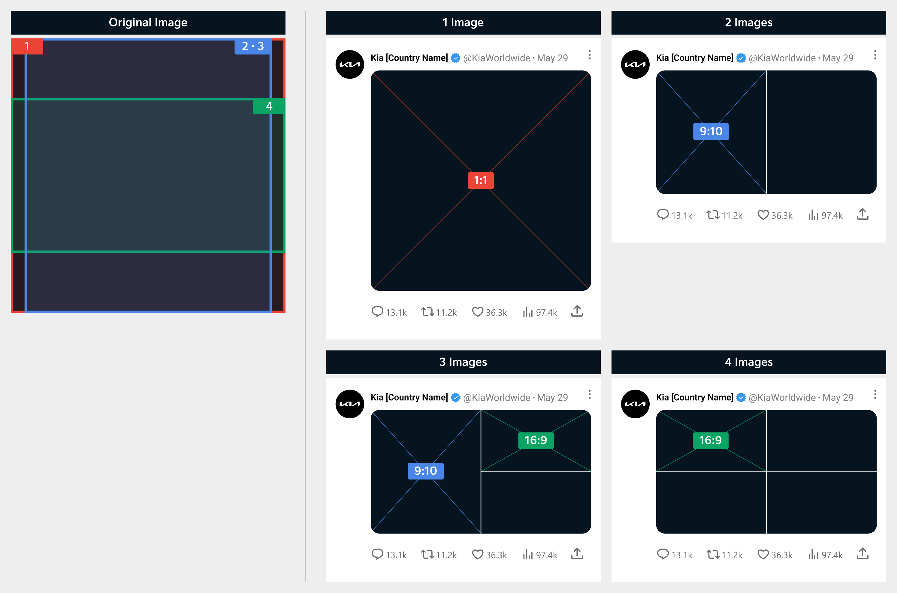

# Image

X supports various aspect ratios, and the display may vary depending on the post format and viewing environment.

### Aspect Ratio

For best results, we recommend following the guidelines below.

• Up to 4 media items can be uploaded in a single post with a free X account.

• When uploading multiple media items in a single post, use the same aspect ratio and dimensions across all media to ensure a consistent layout.

| Media type                                  | Aspect Ratio                                                                                                |
| ------------------------------------------- | ----------------------------------------------------------------------------------------------------------- |
| Single image                                | 1:1 or 4:5                                                                                                  |
| Single video                                | 9:16                                                                                                        |
| Multiple media items (images and/or videos) | 
1:1, 4:5 or 9:16

*Same aspect ratio and dimensions recommended for all media in a single post.
 |

<figure><figcaption></figcaption></figure>

***

### Layout

Ensure your content is designed with the safe zone in mind to prevent cropping, and follow the recommended aspect ratios for each platform.

#### Single Image

It is displayed in its original aspect ratio (1:1).

<figure><figcaption></figcaption></figure>

<figure><figcaption></figcaption></figure>

#### **Two or Three Images**

An original image (1:1) is displayed in a 9:10 aspect ratio.

<figure><figcaption></figcaption></figure>

<figure><figcaption></figcaption></figure>

#### Four Images

An original image (1:1) is displayed in a 16:9 aspect ratio.

<figure><figcaption></figcaption></figure>

<figure><figcaption></figcaption></figure>


You can place text in all areas except for the margin and text is recommended to be left- or center-aligned.


***

### Typography

#### Headline

* Font: Kia Signature Regular&#x20;
* Size: 72pt&#x20;
* Line height: 94pt
* Letter Spacing: 25px

#### Sub-headline

* Font: Kia Signature Regular&#x20;
* Size: 48pt&#x20;
* Line height: 62pt
* Letter Spacing: 20px

